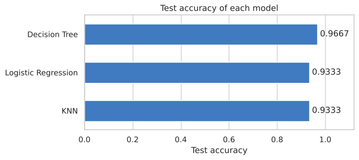
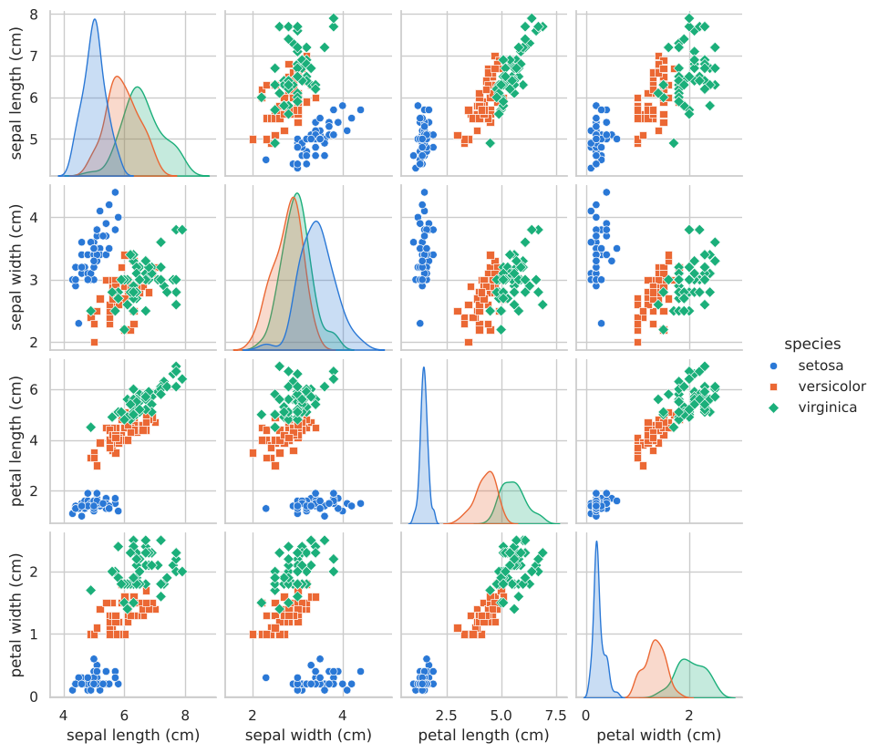
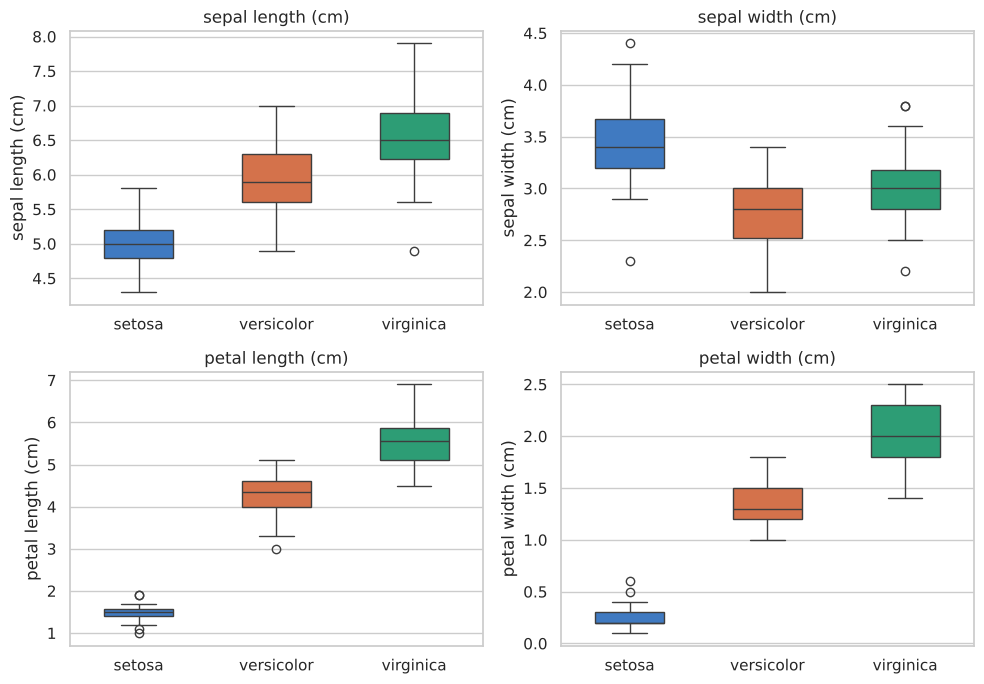
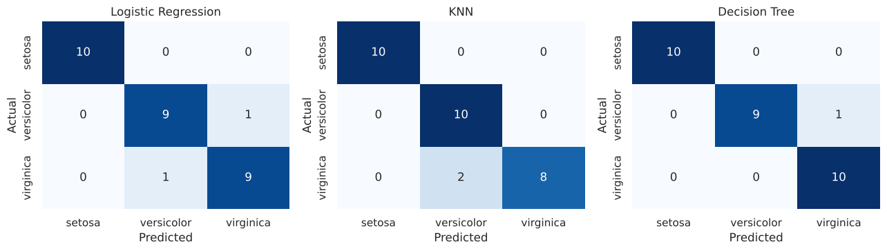

# Iris Flower Classification

**Oasis Infobyte Internship (OIBSIP) · Data Science · Task 1**
**Author:** Robin Kumar

A machine learning project that predicts the species of an iris flower (Setosa, Versicolor or Virginica) from four measurements: sepal length, sepal width, petal length and petal width.

## Objective

Train a classification model on the Iris dataset, compare different classifiers and select the best-performing one with justification.

## What the notebook covers

| Step | What is done |
|---|---|
| Load data | `sklearn.datasets.load_iris()`, no download needed |
| EDA | Shape, data types, null value check, class counts, descriptive statistics |
| Visualisations | Pairplot by species, box plots for each feature, correlation heatmap |
| Feature selection | Discussion of which features separate the species best |
| Split | 80/20 train/test split with `train_test_split` |
| Models | Logistic Regression, K-Nearest Neighbours, Decision Tree |
| Evaluation | Accuracy, confusion matrix, classification report (precision, recall, F1) |
| Conclusion | Best model selected with justification |

## Results

| Model | Train accuracy | Test accuracy | Correct (out of 30) |
|---|---|---|---|
| **Decision Tree** | 98.33% | **96.67%** | **29** |
| Logistic Regression | 95.83% | 93.33% | 28 |
| K-Nearest Neighbours | 97.50% | 93.33% | 28 |

Test accuracy is measured on 30 flowers that were not used for training.

**Best model: Decision Tree.** It has the highest test accuracy (29 of 30 flowers correct), a small gap between train and test accuracy, and it is easy to understand because it uses simple if/else rules. The three models are very close: the Decision Tree is ahead by only one flower, so the ranking could change with a different split.



## Exploratory analysis

Setosa is clearly separated from the other two species. Versicolor and Virginica overlap slightly.





## Confusion matrices

Setosa is classified correctly by every model. All mistakes are between Versicolor and Virginica.



## Key findings

- Petal length and petal width are the most discriminative features. The Decision Tree uses only these two features.
- Sepal width is the weakest feature, because all three species have similar values.
- All three models are more than 93% accurate on the test set.

## Tech stack

Python · pandas · scikit-learn · matplotlib · seaborn · Jupyter Notebook

## How to run

**Option 1: Google Colab (no installation)**

1. Download `Iris_Flower_Classification.ipynb` from this folder.
2. Open [Google Colab](https://colab.research.google.com) and choose **File → Upload notebook**.
3. Choose **Runtime → Run all**.

**Option 2: Locally**

1. Download or clone this repository and open a terminal in this task's folder.
2. Install the libraries and start Jupyter:

```bash
pip install -r requirements.txt
jupyter notebook Iris_Flower_Classification.ipynb
```

3. Choose **Kernel → Restart & Run All**.

## Folder structure

```
├── Iris_Flower_Classification.ipynb   # notebook with code, outputs and plots
├── README.md                          # project overview
├── requirements.txt                   # Python libraries needed
└── images/                            # plots used in this README
```

## Dataset

The Iris dataset has 150 flowers, 4 features and 3 species (50 flowers each). It is built into scikit-learn.

## Acknowledgements

- scikit-learn and seaborn documentation.
- An AI assistant was used for guidance while building this notebook.
