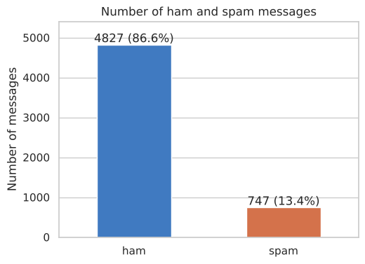
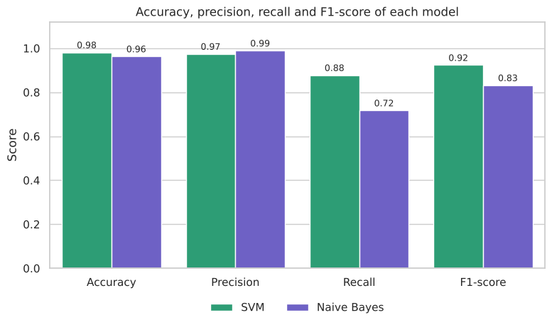
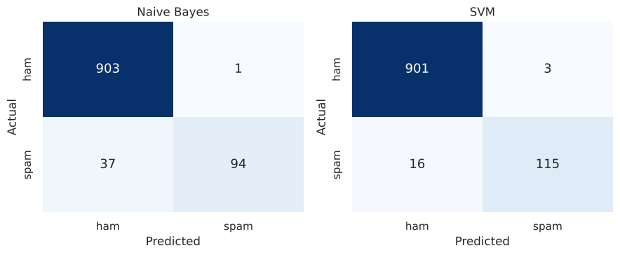
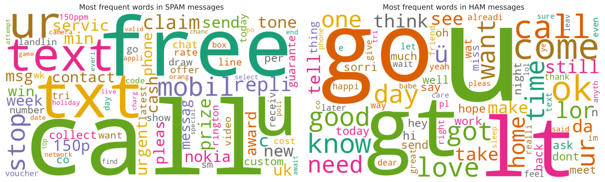

# Email Spam Detection with Machine Learning

**Oasis Infobyte Internship (OIBSIP) · Data Science · Task 4**
**Author:** Robin Kumar

A Natural Language Processing (NLP) project that classifies text messages as **spam** or **ham** (legitimate) using TF-IDF features and machine learning classifiers.

## Objective

Clean and preprocess raw message text, convert it into numbers with TF-IDF, train two classifiers and select the one that detects spam best.

## Dataset

SMS Spam Collection from the UCI Machine Learning Repository, saved in this folder as `sms_spam_collection.tsv`.

- 5,574 messages: 4,827 ham (86.6%) and 747 spam (13.4%)
- 5,171 messages remain after removing duplicates



## What the notebook covers

| Step | What is done |
|---|---|
| Data loading | Class distribution check: spam vs. ham counts and percentages |
| Data cleaning | Null value check, duplicate removal |
| Text preprocessing | Lowercase conversion, punctuation removal, stopword removal (NLTK), stemming (Porter stemmer) |
| WordClouds | Most frequent words in spam and in ham messages |
| Split | 80/20 stratified train/test split |
| Feature extraction | TF-IDF Vectorizer, with an explanation of what TF-IDF measures |
| Models | Multinomial Naive Bayes, Support Vector Machine (LinearSVC) |
| Evaluation | Accuracy, precision, recall, F1-score, confusion matrix |
| Discussion | Why recall is important for spam detection |

## Results

| Model | Accuracy | Precision | Recall | F1-score |
|---|---|---|---|---|
| **SVM (LinearSVC)** | **98.16%** | 97.46% | **87.79%** | **0.9237** |
| Multinomial Naive Bayes | 96.33% | 98.95% | 71.76% | 0.8319 |

Measured on 1,035 test messages (904 ham, 131 spam).

**Best model: Support Vector Machine.** It caught 115 of the 131 spam messages and wrongly marked only 3 of the 904 ham messages as spam. Naive Bayes has the highest precision, but it misses more than one in four spam messages.





## Why recall matters

Recall is the share of real spam messages that the model catches. A spam filter exists to catch spam, and missed spam can contain scams or phishing links. Accuracy alone is misleading here: about 87% of the messages are ham, so a model that says "ham" every time would already be 87% accurate while catching no spam at all. Precision still matters too, because a ham message marked as spam may be an important message the user never sees.

## WordClouds

Spam messages are full of words like "call", "free", "txt", "claim" and "prize". Ham messages contain everyday words.



## Tech stack

Python · pandas · scikit-learn · NLTK · WordCloud · matplotlib · seaborn · Jupyter Notebook

## How to run

**Option 1: Google Colab (no installation)**

1. Download `Spam_Detection.ipynb` and `sms_spam_collection.tsv` from this folder.
2. Open [Google Colab](https://colab.research.google.com) and choose **File → Upload notebook**.
3. Click the folder icon on the left and upload `sms_spam_collection.tsv`.
4. Choose **Runtime → Run all**.

**Option 2: Locally**

1. Download or clone this repository and open a terminal in this task's folder.
2. Install the libraries and start Jupyter:

```bash
pip install -r requirements.txt
jupyter notebook Spam_Detection.ipynb
```

3. Choose **Kernel → Restart & Run All**. The notebook downloads the NLTK stopword list the first time it runs, so an internet connection is needed.

## Folder structure

```
├── Spam_Detection.ipynb         # notebook with code, outputs and plots
├── sms_spam_collection.tsv      # dataset
├── README.md                    # project overview
├── requirements.txt             # Python libraries needed
└── images/                      # plots used in this README
```

## Acknowledgements

- Dataset: SMS Spam Collection, UCI Machine Learning Repository.
- scikit-learn and NLTK documentation.
- An AI assistant was used for guidance while building this notebook.
