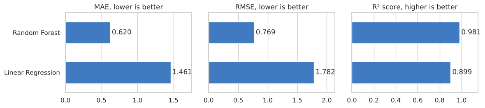
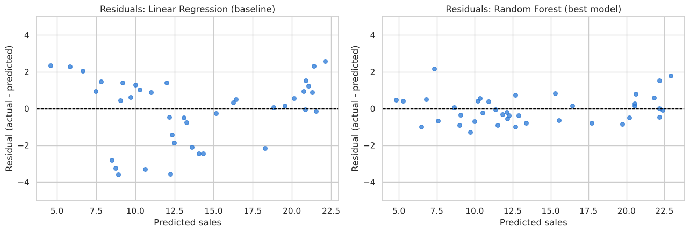
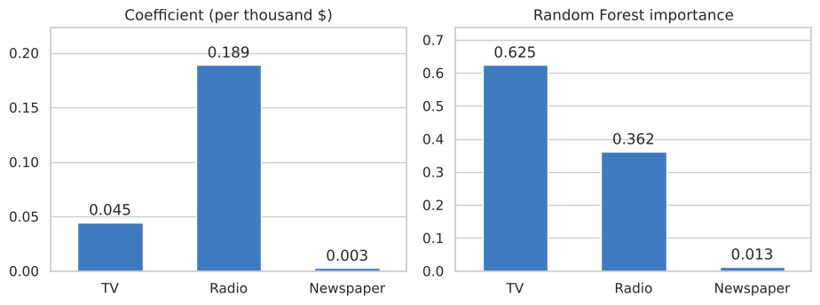
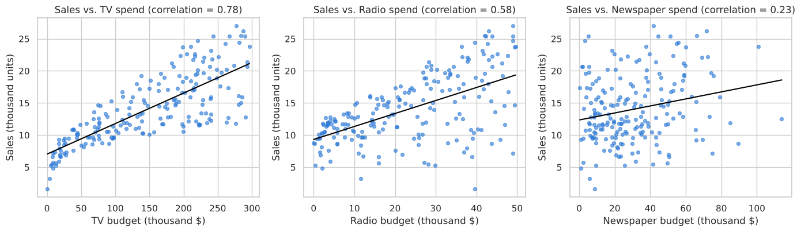
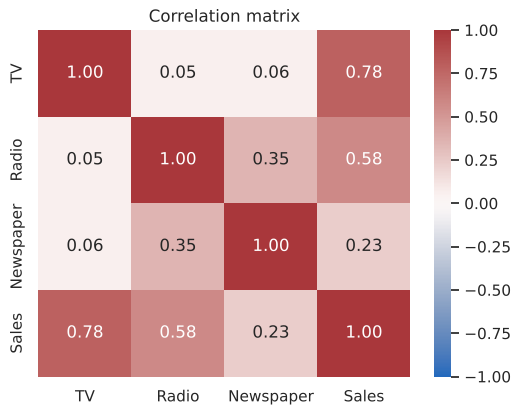

# Sales Prediction Using Python

**Oasis Infobyte Internship (OIBSIP) · Data Science · Task 5**
**Author:** Robin Kumar

A machine learning project that predicts product sales from the money spent on advertising in three media channels: TV, Radio and Newspaper.

## Objective

Explore how advertising spend relates to sales, build regression models that predict sales, and find out which advertising channel has the highest impact.

## Dataset

The classic `Advertising.csv` dataset, saved in this folder.

- 200 markets and 4 columns: `TV`, `Radio`, `Newspaper` (advertising budgets in thousands of dollars) and `Sales` (in thousands of units)
- No null values and no duplicates

## What the notebook covers

| Step | What is done |
|---|---|
| Data loading and EDA | Null check, descriptive statistics, pairplot of all features |
| Scatter plots | Sales vs. TV spend, Sales vs. Radio spend, Sales vs. Newspaper spend |
| Correlation | Correlation matrix heatmap |
| Split | 80/20 train/test split |
| Baseline model | Linear Regression |
| Additional model | Random Forest Regressor |
| Evaluation | MAE, RMSE and R² score |
| Residual plot | Residuals of the best model, compared with the baseline |
| Interpretation | Which channel has the highest impact, using coefficients and feature importance |

## Results

| Model | MAE | RMSE | R² score |
|---|---|---|---|
| **Random Forest** | **0.620** | **0.769** | **0.981** |
| Linear Regression (baseline) | 1.461 | 1.782 | 0.899 |

Measured on 40 test rows. Sales are in thousands of units.

**Best model: Random Forest Regressor.** It has the higher R² score, and its errors are less than half of the baseline's. Linear Regression can only fit a straight-line formula, while Random Forest can also learn curved relationships and combinations of channels.



## Residual plot

The baseline's residuals form a U-shape, which means its errors are systematic. The residuals of the best model are scattered randomly around zero.



## Which channel has the highest impact on sales?

| Channel | Coefficient (per thousand $) | Random Forest importance | Correlation with Sales |
|---|---|---|---|
| TV | 0.0447 | 0.625 | 0.78 |
| Radio | 0.1892 | 0.362 | 0.58 |
| Newspaper | 0.0028 | 0.013 | 0.23 |

- **TV has the highest overall impact on sales.** It has the highest feature importance and the strongest correlation with sales.
- **Radio gives the most sales per dollar.** An extra 1,000 dollars on radio adds about 189 units of sales, compared with about 45 units for TV. TV budgets are far larger than radio budgets, so in total TV accounts for more of the sales.
- **Newspaper has almost no impact** once TV and radio are taken into account.



## Exploratory analysis





## Tech stack

Python · pandas · NumPy · scikit-learn · matplotlib · seaborn · Jupyter Notebook

## How to run

**Option 1: Google Colab (no installation)**

1. Download `Sales_Prediction.ipynb` and `Advertising.csv` from this folder.
2. Open [Google Colab](https://colab.research.google.com) and choose **File → Upload notebook**.
3. Click the folder icon on the left and upload `Advertising.csv`.
4. Choose **Runtime → Run all**.

**Option 2: Locally**

1. Download or clone this repository and open a terminal in this task's folder.
2. Install the libraries and start Jupyter:

```bash
pip install -r requirements.txt
jupyter notebook Sales_Prediction.ipynb
```

3. Choose **Kernel → Restart & Run All**.

## Folder structure

```
├── Sales_Prediction.ipynb   # notebook with code, outputs and plots
├── Advertising.csv          # dataset
├── README.md                # project overview
├── requirements.txt         # Python libraries needed
└── images/                  # plots used in this README
```

## Acknowledgements

- Dataset: Advertising dataset from "An Introduction to Statistical Learning".
- scikit-learn and seaborn documentation.
- An AI assistant was used for guidance while building this notebook.
